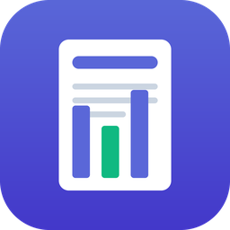
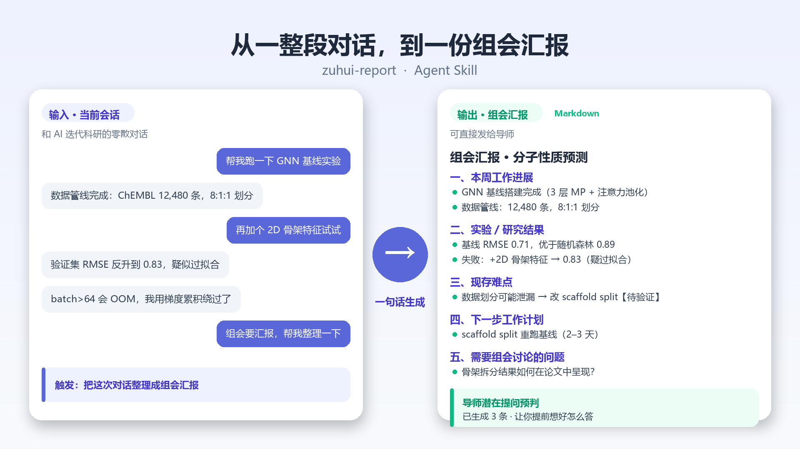

<div align="center">



# 📝 zuhui-report

**Turn a whole research session with your AI into a lab-meeting report — in one shot.**

<sub>One minute before group meeting, pull the progress, results, blockers, and plans scattered across a conversation into a Markdown report you can hand to your advisor.</sub>

<sub><a href="./README.md">中文</a> · <b>English</b></sub>

[](https://agentskills.io)
[](https://developers.openai.com/codex/skills/)
[](https://claude.ai/code)
[](./LICENSE)
[](#-output-sample)

</div>

<div align="center">



<sub>Input: scattered chat with your AI &nbsp;→&nbsp; Output: a report you can send to your advisor</sub>

</div>

---

## 😩 Sound familiar?

> One hour before group meeting. You're staring at hundreds of turns of debugging, deriving, and coding with your AI.
>
> You need to report, but:
> - progress and "still thinking about it" are mixed together, and you can't tell what's actually done;
> - you'd rather not mention the failed experiments — but you know your advisor will ask;
> - writing a report from scratch takes half an hour just to organize the words.

**zuhui-report is built for exactly this moment.** It reads no files, needs no setup, and never goes online — it works directly from the **context of your current session**, distills the research content, and outputs a report you can send straight to your advisor.

## ✨ What it does

- **Five-way extraction**: completed work / experiments & results / current blockers / next steps / questions to discuss — sorted in one pass.
- **Done vs. planned, strictly separated**: anything that is only an idea and not yet verified is tagged **【待验证】(to be verified)** — "I want to" never gets written as "I did".
- **Failed experiments recorded honestly**: no polishing, no dodging — often the exact thing advisors want to see.
- **Three output modes**: `full` written report / `brief` spoken outline / `ppt-outline` points ready to paste into slides.
- **Advisor question prediction**: generates 3–5 questions your advisor is likely to ask, so you can prepare answers.
- **Markdown only**: no PPT files, no exaggeration, every line traceable to the conversation.

## 🚀 Install

`zuhui-report` is a standard Agent Skill (`SKILL.md` + `agents/openai.yaml`).

### Option 1: Codex (recommended)

Put the repo where Codex scans for skills:

```bash
# Project-level (travels with the repo, shared by the team)
git clone <this-repo> .agents/skills/zuhui-report

# User-level (available in every project on this machine)
git clone <this-repo> ~/.agents/skills/zuhui-report
```

In Codex, just say what you want, or invoke it explicitly with `/skills` or `$zuhui-report`.

### Option 2: Claude Code

```bash
git clone <this-repo> ~/.claude/skills/zuhui-report
```

### Option 3: Let an AI install it

Paste this to any AI coding agent:

```text
Please install the zuhui-report Agent Skill:
1. Clone the repo into .agents/skills/zuhui-report (or .claude/skills/zuhui-report for Claude Code).
2. Read and follow the SKILL.md and agents/openai.yaml inside.
3. When done, tell me where it went and how to use it.
```

## 🗣️ Usage

At the end of any research session with your AI, just say:

```
Turn this conversation into a group-meeting report
```

With options:

```
Use brief mode, no appendix, keep it under 800 words
```

```
Generate a report as ppt-outline only, and predict my advisor's questions
```

## 🎛️ Configuration

| Option | Values | Default | Description |
|---|---|---|---|
| `output_mode` | `brief` / `full` / `ppt-outline` | `full` | Outline / full report / slide points |
| `include_appendix` | `true` / `false` | `true` | Add references and key code-change summary |
| `include_question_prediction` | `true` / `false` | `true` | Predict the advisor's likely questions |
| `filter_debug_noise` | `true` / `false` | `true` | Filter debug logs, dead drafts, chit-chat |
| `max_words` | integer | `2000` | Max body length of the report |

## 📋 Output sample

Every mode ships with a viewable example:

- 📝 Full written report: [`examples/example-output.md`](examples/example-output.md)
- 🗣️ Spoken outline (`brief`): [`examples/example-output-brief.md`](examples/example-output-brief.md)
- 📊 Slide points (`ppt-outline`): [`examples/example-output-ppt-outline.md`](examples/example-output-ppt-outline.md)
- 🇬🇧 English full report: [`examples/example-output-en.md`](examples/example-output-en.md)

Structure:

```markdown
# Group Meeting Report - [Project]
## 1. Progress This Week
## 2. Experiments / Results       # valid results and failures listed separately
## 3. Current Blockers            # includes what you already tried
## 4. Next Steps                  # broken into concrete, measurable tasks
## 5. Questions for Discussion
## Appendix                       # optional: references / code summary
## Predicted Advisor Questions    # optional: 3-5 items
```

## 🗂️ Repository structure

```text
zuhui-report/
├── SKILL.md                 # Core: workflow, extraction rules, template, constraints
├── agents/
│   └── openai.yaml          # Codex UI metadata (display name, default prompt, icons)
├── assets/                  # Skill icons + README demo image
├── examples/                # Sample outputs per mode (full / brief / ppt-outline / EN)
├── scripts/                 # Script that generates the README demo image
├── README.md / README_en.md
└── LICENSE
```

## 🚧 Scope & FAQ

- **Does it read files?** No. It only reads the **current session context** — that's why there's zero setup.
- **Does it generate PPT?** No, Markdown only (the `ppt-outline` mode returns paste-ready text). Pair it with a PPT skill if you need `.pptx`.
- **Can it work without a conversation?** No. With no context it will tell you what's missing instead of inventing content.
- **Will it fabricate results?** The constraints hard-require "everything must come from the current conversation", and unverified ideas are always tagged 【待验证】.

## 🤝 Contributing

Issues and PRs welcome: new output templates, better question-prediction heuristics, and more examples are all valuable.

## 📄 License

[MIT](./LICENSE)

<div align="center"><sub>If group meetings always sneak up on you, give it a ⭐ so more people can find it.</sub></div>
